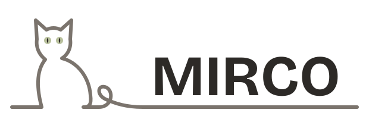

<picture>
  <source media="(prefers-color-scheme: dark)" srcset="docs/logo/mirco-wordmark-dark.svg">
  
</picture>

MIRCO, a science kit in Hilde: Matrices, Interpolation, Random numbers, Calculus, Optimization

Website: https://hilde-lang.org/mirco/

# MIRCO

MIRCO is the science kit of [Hilde](https://github.com/heikozim/hilde):
it has the place in Hilde that NumPy and SciPy have in Python.  It is a
package of Hilde with the prefix `Mirco`.

## Features

- **Arrays:** element types, views, broadcasting, computing over arrays
  (`Mirco.Array`, `Mirco.Compute`, `Mirco.Element`)
- **Linear algebra:** `Mirco.Linalg` in pure Hilde, `Mirco.Lapack` on BLIS and LAPACK in C (`c/`)
- **Numerics:** interpolation, integration, root finding, minimization and
  optimization, FFT, statistics (`Mirco.Interpolate`, `Mirco.Integrate`,
  `Mirco.Minimize`, `Mirco.Optimize`, `Mirco.Fft`, `Mirco.Stats`)
- **Random numbers:** `Mirco.Random`
- **Units:** quantities with their SI unit in the type (`Mirco.Units`)
- **Files:** CSV, HDF5, netCDF, CERN's ROOT, tables in SQLite or DuckDB, xz and zstd
- **Notebooks:** `tools/mirco-notebook` runs a notebook of cells
- **Pages:** BRUNO (Bridge Rendering Unified Numeric Output) shows tables,
  summaries and charts as HTML and SVG on Wolly pages (`Mirco.Bruno`)

All modules are described in [docs/mirco.en.md](docs/mirco.en.md).

## Quick start

```sh
HILDE=/path/to/hilde sh scripts/gate.sh
```

The gate builds the C backend first: BLIS 2.1, the C translation of
LAPACK from OpenBLAS 0.3.34 and pocketfft from NumPy, all in `c/`
(`c/NOTICE` names their sources and licences). To build it alone:

```sh
sh tools/build-c.sh
export PKG_CONFIG_PATH=$PWD/_c/lib/pkgconfig
```

It needs a C compiler, GNU make, python3 and perl; no Fortran.

## Testing

| Command | Purpose |
|---|---|
| `sh scripts/gate.sh` | the full gate: the checks of the package, its tests, the form of its sources and the contracts |
| `sh scripts/gate.sh --quick` (`-q`) | the quick gate for a change: only the modules touched since the merge base with main and those that import them directly; writes no `_gate/` and no `GATE-RESULT` |

A release needs the full gate.  A change to the gate, the build or shared
configuration falls back to the full gate.

## Layout

- `src/`: the modules, `Mirco.Array` in `src/Array.hih` and so on
- `docs/mirco.en.md`: the documentation
- `examples/`: Python, scripts and units
- `tools/`: the notebook and the runner

## License

Copyright (c) 2026 Heiko Zimmermann <code@heiko-zimmermann.com>

MIRCO is licensed under the Apache License 2.0 with LLVM Exceptions; see
[LICENSE](LICENSE).
