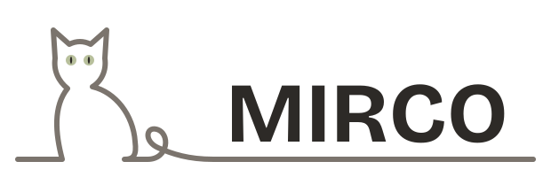

<picture>
  <source media="(prefers-color-scheme: dark)" srcset="docs/logo/mirco-wordmark-dark.svg">
  
</picture>

MIRCO, a science kit in Hilde: Matrices, Interpolation, Random numbers, Calculus, Optimization

Website: https://hilde-lang.org/mirco/

# Mirco

Mirco is the science kit of Hilde: matrices, interpolation, random numbers, calculus and optimization, in the
place NumPy and SciPy have for Python. It is a package of Hilde with the prefix `Mirco`.

- `src/` holds the modules, `Mirco.Array` for `src/Array.hih` and so on.
- `docs/mirco.en.md` describes them.
- `tools/mirco-notebook` runs a notebook of cells.
- `scripts/gate.sh` is the gate: the checks of the package, its tests, the form of its sources and the
  contracts, run with a built Hilde and the C backend mirco-blis, which it builds first. mirco-blis is not
  published yet.

```sh
HILDE=/path/to/hilde MIRCO_BLIS=/path/to/mirco-blis sh scripts/gate.sh
```

`sh scripts/gate.sh --quick` (`-q`) is the quick gate for a change: it builds and tests only the modules touched
since the merge base with main and those that import them directly. It writes no `_gate/` and no `GATE-RESULT`;
a release needs the full gate. A change to the gate, the build or shared configuration falls back to the full
gate.

Copyright (c) 2026 Heiko Zimmermann <code@heiko-zimmermann.com>

MIRCO is licensed under the Apache License 2.0 with LLVM exception; see LICENSE.
